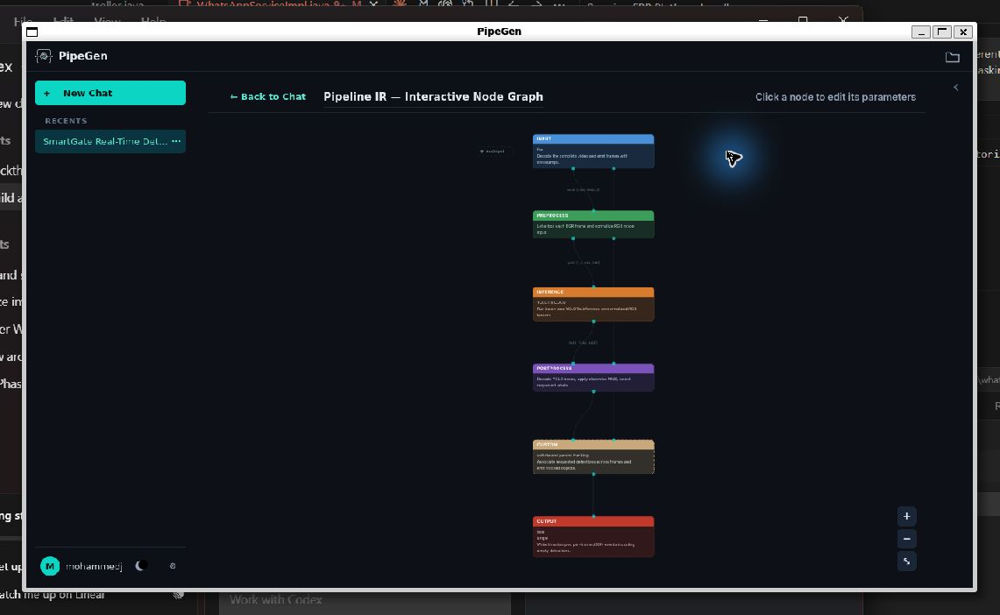
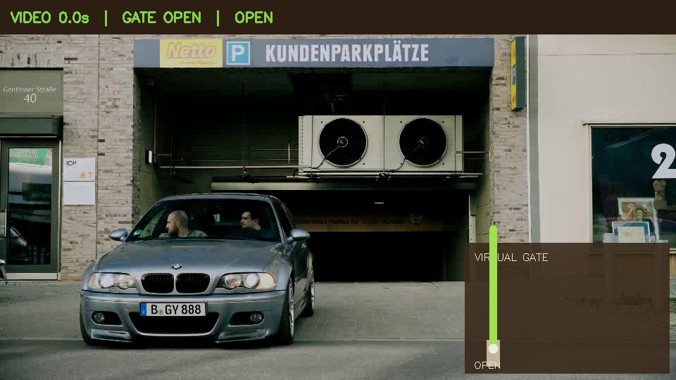

# SmartGate AI — apartment access simulator

A guided Streamlit + SQLite prototype with animated gate movement, entry and exit, fictional resident approvals and a persistent audit trail.

## Start

From `C:\Users\moham\Desktop\hackthon`:

```powershell
.\.venv\Scripts\python.exe -m streamlit run app.py --server.address 127.0.0.1
```

Open http://127.0.0.1:8501. Existing records are preserved and the schema upgrades automatically. `start.ps1` is an alternative launcher.

Fresh installation (Python 3.11+):

```powershell
python -m venv .venv
.\.venv\Scripts\python.exe -m pip install -r requirements-dev.txt
```

If ensurepip fails but creates the interpreter:

```powershell
python -m pip --python .venv\Scripts\python.exe install -r requirements-dev.txt
```

## The best first demo

For actual footage, open **Video Gate**. The built-in Pexels parking-entrance video is already downloaded on this machine. Choose **Access given** (assign an active demo plate) or **Access denied** (a revoked demo plate), then **Play video & run gate**. Real YOLOX-s / ONNX Runtime CUDA detections (or selectable YOLOv4-tiny / OpenCV CPU detections) trigger one access request per run. The virtual gate operates alongside the processed video frames, logs the result, and updates occupancy. Pause, Resume and Stop are available. Choose **Upload my own video** to use MP4, MOV, AVI or WebM locally. Choose Exit and an existing visit to demonstrate video-triggered departure.

**No plate OCR is implemented:** identities are explicitly operator-assigned test values; the same footage can exercise both policies. Detection boxes are real, the gate and physical crossing timer are simulated. Preview playback is full video playback; analysis playback displays sampled frames at up to 4 fps without audio. One selected vehicle identity is associated with the first vehicle detection; this is not multi-vehicle tracking.

To restore the downloadable sample and detector assets on another machine:

```powershell
.\.venv\Scripts\python.exe scripts/download_video_assets.py
```

See `docs/video-sources.md` for provenance and licensing. Detection JSON reports are saved under `data/video_reports/`; access decisions remain in the regular SQLite audit log with `source=cpu_vision`.

Open **Live Simulator → Play full entry + exit demo**. A registered vehicle completes two animated cycles:

1. Entry: authorization → barrier opens → car crosses → entry saved → barrier closes.
2. Exit: recorded visit matched → barrier opens → car crosses out → visit completed → barrier closes.

The gate state and counts update during the animation. Completed crossings alone change occupancy. Every new complete cycle records arrival, policy decision, gate opening, passage and closure. The page shows the activity log and vehicles inside; **Access Logs** provides filters, local/UTC time and CSV/JSON exports.

For an approval demo choose **Unknown vehicle**, **Visitor**, **Delivery** or **Unreadable plate**, then **Start entry**. The gate stays closed until a selected fictional resident approves. Rejection records the decision without admitting a vehicle. **Revoked registration** denies automatic entry. Approval applies to one visit and does not register a vehicle.

Choose **Exit** to select a vehicle currently inside. Exit without entry, duplicate inside entry and replayed event IDs are blocked. Unreadable vehicles receive visit IDs so an approved visit can later exit. If a browser refresh interrupts a cycle, **Resume vehicle passage & close** finishes it; **Cancel / clear current cycle** closes it without inventing an unrecorded crossing.

## What is real

SQLite persistence, authorization rules, normalization, input validation, event deduplication, visit tracking, exports, gate state transitions, application UI and local YOLOv4-tiny vehicle detection on uploaded/downloaded video frames.

## What is simulated

Vehicle identities assigned to video and sample events; illustrated vehicle movement; the physical barrier and passage timer; resident identity/consent; RFID and fingerprint. No biometric data is collected. The Video Gate runs real detection; the separate Vision Integration reference-video uploader remains playback only.

## Competition requirements (Track A — PipeGen)

**Track A is fully verified and complete.**
- **All 5 PipeGen stages executed:** Requirement → Pipeline IR → Model (YOLO11s) → Compiler (TensorRT 10.3 FP16, `yolo11s.fp16.plan`, 27.8 MB) → Run (DeepStream on `parking-entrance.mp4`, 1,098 frames over 18.33s).
- **Measured inference benchmark:** **10.525 ms** per inference (**~95 FPS**) on laptop RTX 3050 GPU (recorded in `docs/pipegen/ModelStage.json`).
- **Real perception integration:** `vision/pipegen_adapter.py` parses real DeepStream metadata (`docs/pipegen/parking-metadata.json`), driving vehicle access decisions (unverified plates require resident intercom approval) and corridor person incidents.
- **Exported PipeGen package:** Preserved in `pipegen-export/` containing `run.sh`, models, DeepStream configs, and C++ metadata parser.

### PipeGen Pipeline IR (Node Graph)


### SmartGate AI Live Execution


## Test

```powershell
.\.venv\Scripts\python.exe -m pytest -q
```

58 tests verify policy, lifecycle, occupancy, migration, all nine pages, video controllers, and the real PipeGen DeepStream metadata parser.

## Source map

- `app.py`: navigation, dashboard, registry, logs, integration and readiness.
- `simulation_ui.py`: animated gate scene, guided controls and full demo.
- `video_ui.py`: source selection, upload, play/pause controls and live analysis fragment.
- `vision/video_service.py`: CPU detector and video-triggered gate controller.
- `vision/gpu_detector.py`: verified YOLOX-s CUDA detector with a persistent inference worker.
- `smartgate.py`: transactions, registry, policy, visits and audit lifecycle.
- `vision/pipegen_adapter.py`: JSON contract validator/importer.
- `data/sample_events.json`: labelled sample events.
- `tests/`: authorization, visits, migrations and Streamlit workflows.
- `docs/architecture.md`: design and JSON contract.
- `docs/gpu-handoff.md`, `docs/pitch.md`, `docs/verification.md`: handoff, pitch and verified results.

This is a local trusted-operator simulator with one shared gate, no login or authenticated vision feed. Keep its localhost binding. Existing audit history from the first version is retained; legacy authorization records do not retroactively create completed visits.

## Private Corridor & CCTV

Upload a local video, choose Private Corridor or Parking CCTV, arm the simulated night mode and select People detected or Any movement. Real detector output or frame differences trigger a visual alarm and simulated safety light; alert episodes persist in a shared SQLite incident timeline with acknowledgment and CSV export. No physical siren, CCTV stream, face identification or automatic night schedule is connected. Frame-motion detection requires a fixed camera and can react to lighting changes.

Mentor explanation: open `docs/SmartGate-mentor-explanation.mp4`, or use Play mentor explanation video in the corridor page. This is a narrated product explanation, not a recording of physical hardware.
